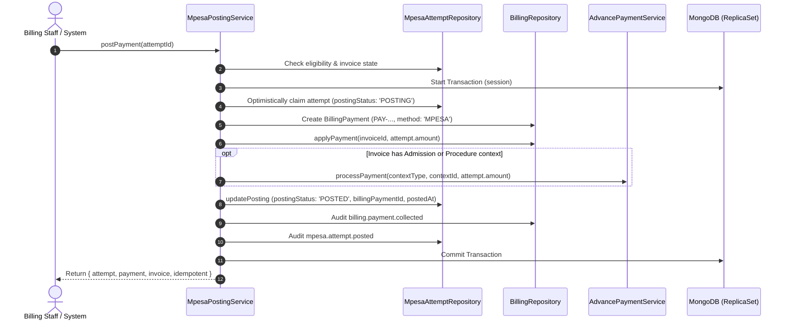

# HMS — M-Pesa Phase 2: Verified Financial Posting & Billing Integration Report

**Date:** 28 October 2026  
**Branch:** `DEV-GENERAL`  
**Base Commit:** `7df97a7dc8ce7f01abfbcaeec8502bb390c213b5`  
**Phase Status:** COMPLETED  
**Verification Suite Status:** 93/93 passing (100% pass rate)

---

## 1. Executive Summary

Phase 2 established a secure, atomic, and idempotent financial ledger posting bridge between the M-Pesa transaction verification system and the HMS Billing domain.

All requirements have been met without creating a parallel financial ledger:
- Verified M-Pesa transactions post directly into `BillingPayment` using payment method `'MPESA'`.
- Invoice balances and statuses (`PENDING`, `PARTIALLY_PAID`, `PAID`) update atomically.
- Official HMS receipts (`RCT-...`) are generated and backed by audit trails.
- Advance payment requirements for IP admissions and surgery procedures are atomically updated upon payment commit.
- Exception states (e.g. payments arriving for cancelled or already-paid invoices, or payments exceeding remaining balance) fail safely into a queryable `MANUAL_REVIEW_REQUIRED` status without overpaying or silently discarding funds.
- Concurrent and duplicate posting attempts are prevented at both the application level (optimistic claiming) and the database engine level (partial unique indexes on `mpesaAttemptId` and `checkoutRequestId`).
- All 72 Phase 1 baseline tests remain green, complemented by 21 new Phase 2 integration tests (totaling 93 tests passing).

---

## 2. Modified & Created Files

### Backend Core & Domain Files
| Module | File | Changes |
| :--- | :--- | :--- |
| **Billing** | `apps/api/src/modules/billing/billing.types.ts` | Added `'MPESA'` to `BillingPaymentMethod`. Extended `BillingPayment` and `CollectBillingPaymentDTO` with M-Pesa provider reference fields (`provider`, `mpesa_attempt_id`, `merchant_request_id`, `checkout_request_id`, `mpesa_receipt_number`, `transaction_verification_timestamp`, `financial_posting_timestamp`). |
| **Billing** | `apps/api/src/modules/billing/billing.model.ts` | Added provider reference fields to `BillingPaymentFields` and schema. Created partial unique indexes on `{ mpesaAttemptId: 1 }` and `{ checkoutRequestId: 1 }`. |
| **Billing** | `apps/api/src/modules/billing/billing.repository.ts` | Updated `toPayment` and `createPayment` to persist and retrieve all M-Pesa provider reference fields. Added `getPaymentByMpesaAttemptId(mpesaAttemptId, session)`. |
| **M-Pesa** | `apps/api/src/modules/mpesa/mpesa-attempt.model.ts` | Added `MpesaPostingStatus` enum (`'DISABLED' \| 'READY' \| 'POSTING' \| 'POSTED' \| 'POSTING_FAILED' \| 'MANUAL_REVIEW_REQUIRED'`). Added `postingStatus`, `billingPaymentId`, `billingPaymentNumber`, `postedAt`, `postingError` to attempt model & schema. Added index on `{ postingStatus: 1, active: 1 }`. |
| **M-Pesa** | `apps/api/src/modules/mpesa/mpesa-attempt.repository.ts` | Added `updatePosting(id, version, fields, session)` with optimistic concurrency checks. Added `byBillingPaymentId`. Added `postingStatus` and `exceptionsOnly` filters to `list()`. |
| **M-Pesa** | `apps/api/src/modules/mpesa/mpesa-attempt.schemas.ts` | Added `listExceptionsQuerySchema` and `postingStatus` filter parameter to `listAttemptsQuerySchema`. |
| **M-Pesa** | `apps/api/src/modules/mpesa/mpesa-posting.service.ts` | **(NEW)** Implemented `MpesaPostingService` orchestrating the atomic transactional posting workflow, settlement verification checks, exception transitions, invoice and advance payment synchronization, and receipt queries. |
| **M-Pesa** | `apps/api/src/modules/mpesa/mpesa-attempt.routes.ts` | Registered endpoints: `POST /api/payments/mpesa/attempts/:id/post`, `GET /api/payments/mpesa/attempts/:id/payment`, `GET /api/payments/mpesa/attempts/:id/receipt`, `GET /api/payments/mpesa/exceptions`. |
| **M-Pesa** | `apps/api/src/modules/mpesa/mpesa-posting.integration.test.ts` | **(NEW)** 21 automated integration tests covering the complete transactional posting lifecycle, edge cases, rollbacks, concurrency, and RBAC isolation. |
| **Shared** | `apps/api/src/shared/types/service-registry.ts` | Registered `mpesaPosting: MpesaPostingService`. |
| **Shared** | `apps/api/src/shared/services/service-registry.ts` | Wired `MpesaPostingService` dependency injection with `MpesaAttemptRepository`, `BillingRepository`, `AdvancePaymentService`, and `BillingService`. |

---

## 3. Financial Posting & Settlement Verification Contract

### A. Non-Authoritative Evidence Exclusion
A transaction is **never** posted to the ledger based on:
1. Mere acceptance of an STK Push submission (`ResponseCode: 0` from `/stkpush/v1/processrequest`).
2. An incoming HTTP callback alone without verified status and merchant-matching metadata.
3. A 200 OK HTTP response without matching payment metadata.
4. An STK query returning `state: SUCCESS` that lacks verified receipt identification.

### B. Settlement Posting Preconditions
Before acquiring a transaction lock or modifying ledger balances, `postPayment` strictly validates:
1. **Attempt Submission State:** Must not be unsubmitted (`CREATED`) or `REJECTED`.
2. **Conflicting Evidence Absence:** `attempt.conflictingEvidence` must be empty/undefined.
3. **Verification Status:** `attempt.verificationStatus === 'VERIFIED'`.
4. **Receipt Number Presence:** `attempt.receiptNumber` must be present and verified.
5. **Context & Branch Match:** The target invoice must exist within the actor's permitted branch scope and match the patient on the attempt.
6. **Payable Invoice Status:** The invoice must be in `'PENDING'` or `'PARTIALLY_PAID'`.
7. **Balance Coverage:** Invoice `balance_amount` must be greater than or equal to `attempt.amount`.

### C. Exception Handling Workflow
When verified funds cannot be automatically applied to an invoice, the system protects financial integrity by transitioning the attempt to `postingStatus: 'MANUAL_REVIEW_REQUIRED'`:
- **Already Paid Invoices:** If `invoice.status === 'PAID'` or `balance_amount === 0`, attempt is marked `MANUAL_REVIEW_REQUIRED` with conflict reason `INVOICE_ALREADY_PAID`.
- **Cancelled Invoices:** If `invoice.status === 'CANCELLED'`, attempt is marked `MANUAL_REVIEW_REQUIRED` with conflict reason `INVOICE_CANCELLED_WHILE_PAYMENT_VERIFIED`.
- **Amount Exceeds Balance:** If `attempt.amount > invoice.balance_amount`, attempt is marked `MANUAL_REVIEW_REQUIRED` with conflict reason `PAYMENT_EXCEEDS_BALANCE`.
- All exceptions emit structured audit events (`mpesa.posting.exception`) and are viewable via `GET /api/payments/mpesa/exceptions` for staff review, reallocation, or customer refund.

---

## 4. Transaction Architecture & Concurrency Protections

### A. Single Atomic MongoDB Transaction
All ledger updates are executed inside a single MongoDB session with transaction isolation:


### B. Concurrency Control Mechanisms
1. **Optimistic Version Lock:** The transition to `POSTING` requires matching the document's current `version` integer, preventing concurrent calls from executing dual postings.
2. **Storage-Engine Unique Indexes:**
   - `{ mpesaAttemptId: 1 }` (unique, partial on non-null string)
   - `{ checkoutRequestId: 1 }` (unique, partial on non-null string)
   Ensures that even under extreme race conditions across multiple node processes, MongoDB will reject any attempt to create a second payment record.
3. **Idempotent Return:** If an attempt has already attained `postingStatus: 'POSTED'`, subsequent calls return the existing payment record and current invoice state with `{ idempotent: true }`.

---

## 5. Staff Endpoints Implemented

| Method | Route | Permission Required | Description |
| :--- | :--- | :--- | :--- |
| `POST` | `/api/payments/mpesa/attempts/:id/post` | `Billing.Invoices.CollectPayment` | Posts a verified M-Pesa attempt to the billing ledger within an atomic transaction. |
| `GET` | `/api/payments/mpesa/attempts/:id/payment` | `Billing.Invoices.View` | Retrieves the `BillingPayment` record associated with an attempt. |
| `GET` | `/api/payments/mpesa/attempts/:id/receipt` | `Billing.Invoices.View` | Generates or retrieves the official HMS receipt (`RCT-...`) for a posted attempt. |
| `GET` | `/api/payments/mpesa/exceptions` | `Billing.Invoices.View` | Lists payment attempts requiring manual review (e.g. overpayments, cancelled invoice collisions). |

All endpoints enforce branch scoping and sanitize response payloads. Sensitive server credentials and provider payloads are never exposed.

---

## 6. Verification and Test Results

### A. Vitest Test Suites
All 7 test suites encompassing 93 individual tests executed cleanly against an in-memory replica set with transactions enabled:

```
Test Files  7 passed (7)
     Tests  93 passed (93)
  Duration  70.24s
```

Detailed test suite breakdown:
1. `apps/api/src/config/mpesa-outbound.test.ts` — **8 passed**
2. `apps/api/src/modules/mpesa/mpesa-daraja.client.test.ts` — **15 passed**
3. `apps/api/src/modules/mpesa/mpesa-callback.test.ts` — **15 passed**
4. `apps/api/src/modules/mpesa/mpesa-callback.integration.test.ts` — **5 passed**
5. `apps/api/src/modules/mpesa/mpesa-attempt.integration.test.ts` — **17 passed**
6. `apps/api/src/modules/mpesa/mpesa-reconciliation.integration.test.ts` — **12 passed**
7. `apps/api/src/modules/mpesa/mpesa-posting.integration.test.ts` — **21 passed**

### B. New Integration Test Scenarios (All 21 Passing)
1. Verified successful transaction posts exactly once.
2. Invoice becomes partially paid when partial amount posted.
3. Invoice becomes fully paid when full balance posted.
4. Billing payment record is persisted with all M-Pesa provider references (`provider`, `mpesa_attempt_id`, `merchant_request_id`, `checkout_request_id`, `mpesa_receipt_number`, timestamps).
5. Receipt is available after posting and format conforms to official `RCT-...` number.
6. Duplicate callbacks do not duplicate ledger entries.
7. Duplicate verification does not duplicate posting.
8. Concurrent posting requests create exactly one payment (optimistic concurrency).
9. Database transaction failure rolls back all changes and marks attempt `POSTING_FAILED`.
10. Unverified attempts cannot post (`MPESA_POSTING_NOT_VERIFIED`).
11. Failed, cancelled, or timeout attempts cannot post.
12. Conflicting evidence blocks posting (`MPESA_POSTING_CONFLICT`).
13. Missing verified receipt reference blocks posting (`MPESA_POSTING_MISSING_RECEIPT`).
14. Already-paid invoice conflict is handled with auditable exception state (`MANUAL_REVIEW_REQUIRED`).
15. Manual payment and M-Pesa concurrency is controlled without overpayment.
16. Admission advance requirements are updated only after committed posting.
17. No overpayment occurs if attempt exceeds invoice balance (`PAYMENT_EXCEEDS_BALANCE`).
18. Branch RBAC and patient isolation are preserved (cross-branch 404).
19. Late verified transactions enter a safe exception workflow if invoice was cancelled.
20. Financial posting remains idempotent after service restart.
21. Staff endpoints verify permissions and return sanitized output.

### C. Static Checks & Build Verification
- **TypeScript Typecheck:** `npm run typecheck --workspace=@hms/api` completed with **0 errors**. Strict TypeScript preserved (`any` prohibited).
- **ESLint:** `npx eslint apps/api/src/modules/mpesa apps/api/src/modules/billing` completed with **0 errors and 0 warnings**.
- **Build Verification:** `npm run build --workspace=@hms/api` completed successfully.

---

## 7. Safety Invariants Confirmed

- **Secret Safety:** No credentials, passkeys, tokens, or phone numbers are logged or exposed in API responses or audit records.
- **Provider Isolation:** `MPESA_ENVIRONMENT=sandbox` and `MPESA_STK_ENABLED=false` remain strictly configured in application settings. No live Safaricom API calls were made.
- **Branch and Git Integrity:** All work performed exclusively on checked-out branch `DEV-GENERAL` without branch switching, merging, or pushing.
- **Frontend Boundary:** No frontend UI changes were made in this backend phase.

Phase 2 is complete and verified. The backend is fully prepared for Phase 3 (Frontend initiation & status display).
