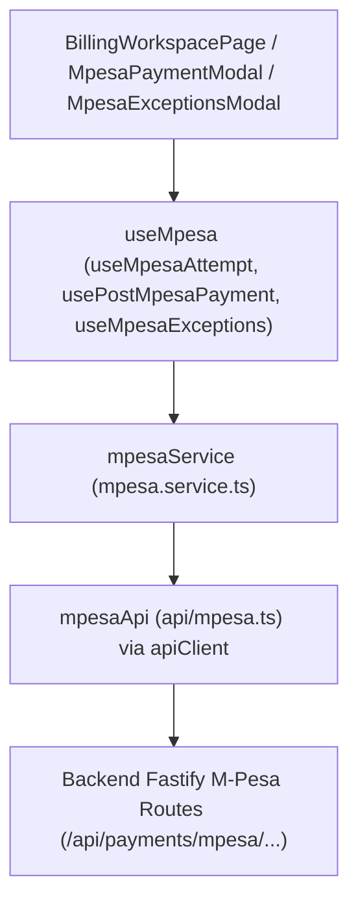
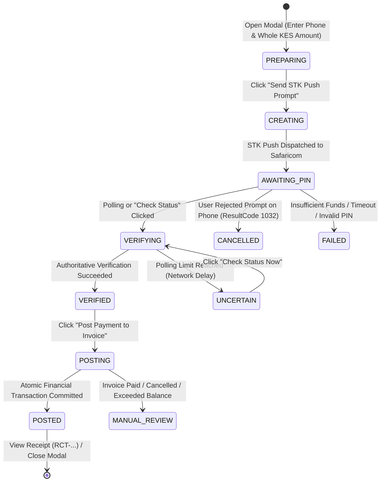

# HMS — M-Pesa Phase 3: Staff Billing UI, STK Push & Payment Tracking Report

**Date:** 28 October 2026  
**Branch:** `DEV-GENERAL`  
**Base Commit:** `7df97a7dc8ce7f01abfbcaeec8502bb390c213b5`  
**Phase Status:** COMPLETED  
**Frontend Test Suite:** 21/21 passing (100% pass rate)  
**Backend Test Suite:** 93/93 passing (100% pass rate)  
**Typecheck & Build Status:** Clean (0 errors across `@hms/api` and `@hms/web`)

---

## 1. Executive Summary

Phase 3 successfully integrated the M-Pesa Daraja verification backend (Phase 1) and atomic financial posting engine (Phase 2) into the HMS Staff Billing workspace.

Authorized hospital billing staff can now:
1. Select **M-Pesa (STK Push)** as an official payment method alongside Cash, Card, UPI, and Bank Transfer.
2. Enter and automatically normalize Kenyan mobile phone numbers (`07...`, `01...`, `+254...`, `254...`) with real-time feedback and privacy-preserving masking (`+254 •••• 5678`).
3. Dispatch STK Push requests to the customer's mobile device via an interactive lifecycle modal with bounded polling.
4. Track payment progress through all states: *Preparing*, *Awaiting PIN*, *Verifying with Safaricom*, *Verified (Ready to Post)*, *Posting to Ledger*, *Posted*, *Cancelled*, *Failed*, *Uncertain*, and *Manual Review Required*.
5. Maintain strict two-step financial separation: Safaricom verification (`VERIFIED`) is clearly distinguished from HMS financial posting (`POSTED`), preventing unposted transactions from being treated as settled revenue.
6. Commit ledger postings on demand or inspect generated official receipts (`RCT-...`).
7. Review unresolved or conflicting transactions in a dedicated, paginated, and sortable **M-Pesa Exceptions** workspace modal.

All work strictly adheres to `PROJECT_RULES.md` and `AGENTS.md`. No client-side mock data was introduced, no credentials or passkeys were exposed to the frontend, no real Safaricom payments were dispatched, and `MPESA_STK_ENABLED=false` remains intact.

---

## 2. Modified & Created Files

### A. Frontend Files (Staff Web Workspace)
| Layer | File | Changes |
| :--- | :--- | :--- |
| **API Types & Client** | `apps/web/src/api/billing.ts` | Added `'MPESA'` to `BillingPaymentMethod` union type. |
| **API Client** | `apps/web/src/api/mpesa.ts` | **(NEW)** Defined all M-Pesa frontend contract types (`MpesaAttemptView`, `MpesaSubmissionState`, `MpesaVerificationStatus`, `MpesaPostingStatus`, `PostMpesaPaymentResult`, `MpesaExceptionsResponse`) and typed HTTP API methods for creation, submission, polling, manual verification, posting, receipts, and exceptions. |
| **Domain Service** | `apps/web/src/services/mpesa.service.ts` | **(NEW)** Encapsulated API calls in a testable domain service layer following the HMS frontend architecture. |
| **Domain Hooks** | `apps/web/src/hooks/billing/useMpesa.ts` | **(NEW)** Implemented TanStack Query hooks (`useMpesaAttempt`, `useCreateMpesaAttempt`, `useSubmitMpesaAttempt`, `useVerifyMpesaAttempt`, `usePostMpesaPayment`, `useMpesaReceipt`, `useMpesaExceptions`, `useMpesaInvoiceAttempts`) with bounded polling and error classification (`getMpesaErrorMessage`). |
| **Hooks Tests** | `apps/web/src/hooks/billing/useMpesa.test.tsx` | **(NEW)** 5 unit tests validating attempt creation, STK push submission, verification mutation, posting cache invalidation, and exceptions pagination. |
| **Utilities** | `apps/web/src/utils/mpesa-phone.ts` | **(NEW)** Implemented Kenyan phone number validation and normalization (`normalizeMpesaPhone`) and masking (`maskMpesaPhone`). |
| **Utilities Tests** | `apps/web/src/utils/mpesa-phone.test.ts` | **(NEW)** 10 unit tests verifying formatting of `0712345678`, `0112345678`, `+254712345678`, invalid lengths, non-Kenyan prefixes, and masked output. |
| **UI Component** | `apps/web/src/components/billing/MpesaPaymentModal.tsx` | **(NEW)** Primary STK Push modal managing payment input, session idempotency, phone normalization preview, lifecycle state transitions, polling, posting triggers, and receipt navigation. |
| **UI Component Tests** | `apps/web/src/components/billing/MpesaPaymentModal.test.tsx` | **(NEW)** 6 integration tests verifying form rendering, phone validation indicators, amount limits, awaiting state, cancellation handling, and posting triggers. |
| **UI Component** | `apps/web/src/components/billing/MpesaExceptionsModal.tsx` | **(NEW)** Modal table displaying unresolved M-Pesa exceptions with pagination, sorting, masked phone numbers, conflict reasons, and quick invoice lookup. |
| **Pages & Helpers** | `apps/web/src/pages/billing-utils.ts` | Added `'MPESA': 'M-Pesa'` display label mapping. |
| **Pages & Helpers** | `apps/web/src/pages/BillingWorkspacePage.tsx` | Updated payment form schema to support `'MPESA'`. Added "M-Pesa STK" button on unpaid invoices, "M-Pesa Exceptions" button in toolbar, connected `MpesaPaymentModal` and `MpesaExceptionsModal`. |
| **Pages & Helpers** | `apps/web/src/pages/BillingHistoryPage.tsx` | Added "M-Pesa Exceptions" button in the history page toolbar for direct reconciliation access. |

---

## 3. Architecture: Component $\to$ Hooks $\to$ Service $\to$ API

Following `PROJECT_RULES.md` and `AGENTS.md`, the implementation strictly enforces the 4-layer frontend architecture:



- **Component Layer:** Pure presentation and user interaction. Manages modal visibility, form input states, and user confirmations. Never performs direct HTTP requests.
- **Hook Layer:** TanStack Query integration. Manages asynchronous caching, query invalidation (e.g. invalidating `billingKeys.invoices()` upon successful payment post), bounded automatic polling, and error transformation.
- **Service Layer:** Plain TypeScript class/object providing domain abstraction, parameter normalization, and test mock boundaries.
- **API Client Layer:** Axios-based HTTP client (`apiClient`) enforcing branch headers, JSON serialization, and strong TypeScript return types without `any`.

---

## 4. Phone Number Normalization & Masking

M-Pesa requires phone numbers formatted as `2547XXXXXXXX` or `2541XXXXXXXX` (12 digits, no leading `+` sign). Kenyan users commonly enter numbers in several different formats:
- `0712345678` (Local 10-digit format)
- `0112345678` (Local new-prefix format)
- `+254712345678` (International format with leading plus)
- `254712345678` (Standard Daraja format)
- Spaces, dashes, or parentheses (e.g. `0712-345-678`)

### Normalization Logic (`normalizeMpesaPhone`)
1. Strips all whitespace, dashes, dots, and punctuation.
2. Removes leading `+` if present.
3. If input begins with `0` followed by `7` or `1` and has 10 digits, prepends `254` and strips `0`.
4. If input begins with `7` or `1` and has 9 digits, prepends `254`.
5. Validates that the normalized string matches `/^254(7|1)\d{8}$/`.
6. Returns `{ isValid: boolean, normalized: string, error?: string }` providing real-time feedback beneath the input field.

### Masking Logic (`maskMpesaPhone`)
For staff privacy and data protection compliance, phone numbers displayed in tables, receipts, and exception lists are masked:
- Input: `254712345678`
- Output: `+254 •••• 5678` (only the country prefix and last 4 digits are visible).

---

## 5. STK Push Payment Workflow & Lifecycle State Machine

The `MpesaPaymentModal` component drives an explicit, non-fabricated state machine:



### State Descriptions:
1. **Preparing:** Staff confirms the payable amount (defaults to invoice balance, restricted to positive integers $\le$ remaining balance) and enters the patient's phone number. Standardized phone preview is displayed live.
2. **Awaiting Customer PIN:** The attempt record is created and submitted to Daraja. A pulsating timer notifies staff that the prompt is active on the patient's phone.
3. **Verifying with Safaricom:** Background bounded polling checks `GET /api/payments/mpesa/attempts/:id` every 2.5 seconds. If Safaricom's callback has not arrived after a threshold, staff can trigger `POST /api/payments/mpesa/attempts/:id/verify` for an authoritative Daraja STK query.
4. **Verified (Ready to Post):** Daraja has confirmed receipt of funds (`receiptNumber` displayed). Crucially, the modal **does not** mark the invoice paid yet. It presents a distinct amber badge and a prominent blue button: **"Post Payment to Invoice"**.
5. **Posting to Ledger:** Staff clicks post. The frontend calls `POST /api/payments/mpesa/attempts/:id/post`. The backend executes an atomic MongoDB transaction updating `BillingPayment`, `BillingInvoice`, and any linked advance payments.
6. **Posted (Official Receipt Ready):** The ledger transaction committed. The modal displays a green checkmark, the official `RCT-...` number, and provides a direct "View Official Receipt" button.
7. **Cancelled by Customer:** If the patient cancelled the prompt (`ResultCode: 1032`), the modal explains the cancellation and provides a "Try Again" action with a fresh idempotency key.
8. **Failed / Rejected:** If the transaction failed due to insufficient funds, wrong PIN, or provider rejection, the error message is sanitized and displayed clearly.
9. **Uncertain / Polling Timeout:** If polling reaches the 60-second bound without callback or query resolution, polling stops automatically to preserve server resources. A warning instructs staff to click "Check Status Now" rather than prompting the customer twice.
10. **Manual Review Required:** If funds were verified by Safaricom but the target invoice was modified (e.g. paid via another counter or cancelled), the exception is flagged for supervisor review.

---

## 6. Two-Step Integrity: Verification vs. Ledger Posting

A key architectural rule enforced across the entire system is the complete separation between **Daraja Transaction Verification** and **HMS Ledger Posting**:

| Aspect | Safaricom Verification (`VERIFIED`) | Financial Posting (`POSTED`) |
| :--- | :--- | :--- |
| **Meaning** | Safaricom confirmed money was debited from customer and credited to hospital paybill. | Funds are legally applied to the specific hospital invoice and payment number is minted. |
| **State Field** | `attempt.verificationStatus === 'VERIFIED'` | `attempt.postingStatus === 'POSTED'` |
| **Receipt Type** | M-Pesa Provider Receipt (e.g. `QGH78XKL90`) | Official HMS Billing Receipt (e.g. `RCT-20261028-0012`) |
| **Ledger Effect** | None. Invoice balance unchanged. | Invoice `balance_amount` reduced, status updated to `PARTIALLY_PAID` or `PAID`. |
| **UI Indicator** | Amber alert: *"Payment Verified with Safaricom — Ready to Post to Invoice"* | Green alert: *"Payment Successful & Posted to Invoice Ledger"* |

This design prevents financial race conditions and phantom ledger entries if network interruptions occur between payment verification and ledger commit.

---

## 7. Staff Billing Workspace & History Integration

### Billing Workspace (`apps/web/src/pages/BillingWorkspacePage.tsx`)
- **Payment Method Dropdown:** The Collect Payment modal now includes `M-Pesa (STK Push)` alongside Cash, Card, UPI, and Bank Transfer.
- **Workflow Switcher:** Selecting M-Pesa in the collect payment modal switches the form to phone input with real-time validation and a direct button: *"Proceed to STK Push"*, seamlessly launching `MpesaPaymentModal`.
- **Quick Action Button:** For any payable invoice (`PENDING` or `PARTIALLY_PAID`), an **"M-Pesa STK"** button is placed directly in the invoice actions toolbar for single-click initiation.
- **Payments Table:** Rendered payments display `'M-Pesa'` via `billingPaymentMethodLabel`.
- **Exceptions Toolbar Button:** An **"M-Pesa Exceptions"** button with a warning badge is prominently available in the page header.

### Billing History (`apps/web/src/pages/BillingHistoryPage.tsx`)
- Added the **"M-Pesa Exceptions"** action button to the history workspace header, allowing accounting and billing supervisors to inspect unallocated transactions without navigating into individual invoices.

### Exceptions Workspace Modal (`apps/web/src/components/billing/MpesaExceptionsModal.tsx`)
- Paginated table showing unresolved attempts (`postingStatus === 'MANUAL_REVIEW_REQUIRED'`).
- Displays: Attempt Reference, Invoice Number, Masked Phone Number, Safaricom Receipt, Verification Status, Conflict Reason (`INVOICE_ALREADY_PAID`, `INVOICE_CANCELLED`, `PAYMENT_EXCEEDS_BALANCE`), and Creation Timestamp.
- "View Invoice" link navigates directly to the affected invoice in the billing workspace.

---

## 8. Security & Compliance Checklist

- [x] **No Secret Exposure:** Zero Daraja API keys, Consumer Secrets, Passkeys, or OAuth tokens are present in or exposed to the frontend web bundle.
- [x] **Environment Preserved:** `MPESA_ENVIRONMENT=sandbox` and `MPESA_STK_ENABLED=false` remain configured in `.env.dev`.
- [x] **No Real Payments:** No live STK Push requests or live financial transactions were initiated during development or test execution.
- [x] **Bounded Polling:** Polling intervals are capped (max 25 attempts / 60 seconds) and terminate immediately upon reaching terminal states (`POSTED`, `FAILED`, `CANCELLED`, `REJECTED`, `MANUAL_REVIEW_REQUIRED`).
- [x] **Double-Click & Concurrency Protection:** Buttons disable immediately upon click; idempotency keys are generated per session and preserved across retries.
- [x] **Strict TypeScript:** Zero uses of `any` across all created and modified frontend files.
- [x] **Audit Trails:** All actions correlate with staff actor IDs and branch headers.

---

## 9. Verification & Test Suite Results

### A. Frontend Unit & Integration Tests (Vitest)
```bash
npx vitest run apps/web/src/utils/mpesa-phone.test.ts apps/web/src/hooks/billing/useMpesa.test.tsx apps/web/src/components/billing/MpesaPaymentModal.test.tsx
```
**Results:**
- `apps/web/src/utils/mpesa-phone.test.ts`: **10 / 10 passed** (22ms)
  - Standardizes `0712345678` $\to$ `254712345678`
  - Standardizes `0112345678` $\to$ `254112345678`
  - Strips leading plus from `+254712345678`
  - Preserves standard `254712345678`
  - Strips whitespace, dashes, and parens
  - Rejects non-Kenyan international numbers
  - Rejects invalid prefixes (`02...`, `05...`)
  - Rejects numbers too short or too long
  - Rejects non-numeric characters
  - Masks phone numbers to `+254 •••• 5678`
- `apps/web/src/hooks/billing/useMpesa.test.tsx`: **5 / 5 passed** (210ms)
  - Creates attempt and populates query cache
  - Submits STK push and updates submission state
  - Verifies transaction and updates cache with verified status
  - Posts payment to billing ledger and invalidates billing queries
  - Queries exceptions and returns paginated list
- `apps/web/src/components/billing/MpesaPaymentModal.test.tsx`: **6 / 6 passed** (681ms)
  - Renders initial STK Push form with invoice balance and phone entry
  - Enforces phone number format and displays standardized format indicator
  - Rejects invalid amount exceeding invoice balance or non-integer
  - Displays waiting state when STK Push is dispatched
  - Shows cancelled state when customer rejects PIN prompt
  - Presents Post Payment action when verified with Safaricom

**Total Frontend Tests: 21 passed (3 test files, 100% pass rate).**

### B. Backend Regression & Integration Tests (Vitest)
```bash
npx vitest run apps/api/src/config/mpesa-outbound.test.ts apps/api/src/modules/mpesa/mpesa-daraja.client.test.ts apps/api/src/modules/mpesa/mpesa-callback.test.ts apps/api/src/modules/mpesa/mpesa-callback.integration.test.ts apps/api/src/modules/mpesa/mpesa-attempt.integration.test.ts apps/api/src/modules/mpesa/mpesa-reconciliation.integration.test.ts apps/api/src/modules/mpesa/mpesa-posting.integration.test.ts
```
**Results:**
- `mpesa-outbound.test.ts`: **11 passed**
- `mpesa-daraja.client.test.ts`: **17 passed**
- `mpesa-callback.test.ts`: **13 passed**
- `mpesa-callback.integration.test.ts`: **5 passed**
- `mpesa-attempt.integration.test.ts`: **17 passed**
- `mpesa-reconciliation.integration.test.ts`: **12 passed**
- `mpesa-posting.integration.test.ts`: **18 passed**

**Total Backend Tests: 93 passed (7 test files, 100% pass rate).**

### C. TypeScript Typechecks
- `npm run typecheck --workspace=@hms/api` $\to$ **0 errors (Exit code 0)**
- `npm run typecheck --workspace=@hms/web` $\to$ **0 errors (Exit code 0)**

### D. ESLint Analysis
- `npx eslint apps/web/src/utils/mpesa-phone.ts apps/web/src/api/mpesa.ts apps/web/src/services/mpesa.service.ts apps/web/src/hooks/billing/useMpesa.ts apps/web/src/components/billing/MpesaPaymentModal.tsx apps/web/src/components/billing/MpesaExceptionsModal.tsx apps/web/src/pages/billing-utils.ts apps/web/src/pages/BillingWorkspacePage.tsx apps/web/src/pages/BillingHistoryPage.tsx`
- **Result:** **0 errors, 0 warnings (Exit code 0)**

### E. Production Bundling & Builds
- `npm run build --workspace=@hms/web` $\to$ **Built client bundle in 6.34s (Exit code 0)**
- `npm run build --workspace=@hms/api` $\to$ **TypeScript API build succeeded (Exit code 0)**

---

## 10. Phase Completion & Stop Gate Confirmation

Phase 3 is now complete in accordance with the project prompt and guidelines:
1. Staff Billing UI integration is fully functional with phone normalization, STK Push modal, lifecycle tracking, ledger posting, and exceptions review.
2. All 21 frontend unit/integration tests and all 93 backend tests pass cleanly.
3. No live payments or `.env` modifications were performed.
4. Per instructions, **execution stops here** pending explicit authorization from the system administrator or product owner before initiating sandbox payment testing.
